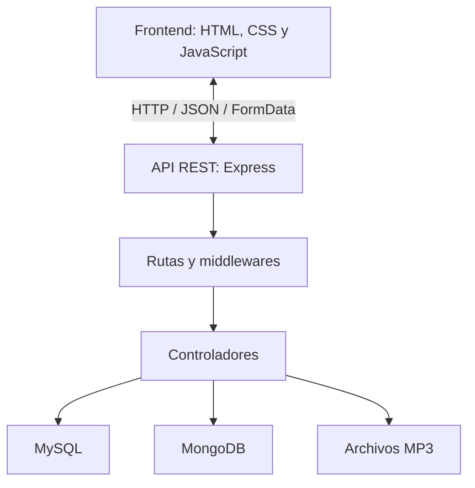

# Plataforma musical y comunidades


## Descripción

Plataforma web musical que permite escuchar, registrar y organizar canciones, además de participar en comunidades según los intereses musicales de los usuarios.

El proyecto fue desarrollado como trabajo académico de Bases de Datos II de la Institución Universitaria Pascual Bravo. Su propósito técnico es integrar una base de datos relacional y una no relacional mediante una API REST, aplicando el enfoque de persistencia políglota.

## Funcionalidades

- Registro e inicio de sesión de usuarios.
- Registro, consulta, edición y eliminación de canciones.
- Gestión de artistas y álbumes.
- Reproductor musical con controles de reproducción, progreso y volumen.
- Creación y administración de playlists.
- Creación, edición y eliminación de comunidades.
- Participación en comunidades según intereses musicales.
- Publicaciones con canciones adjuntas opcionales, comentarios y likes.
- Filtros de búsqueda, géneros musicales y publicaciones recientes o populares.
- Validaciones de propiedad para editar y eliminar contenido.

## Tecnologías

| Componente | Tecnología |
|---|---|
| Frontend | HTML5, CSS3 y JavaScript |
| Backend | Node.js y Express |
| Base de datos relacional | MySQL |
| Base de datos no relacional | MongoDB |
| Acceso a datos | mysql2 y MongoDB Node.js Driver |
| Carga de archivos | Multer |
| Hash de contraseñas | bcryptjs |
| Variables de entorno | dotenv |
| Control de versiones | Git y GitHub |

## Arquitectura

La aplicación utiliza una arquitectura cliente-servidor con un backend modular organizado en rutas, controladores, middlewares y configuración.



### Integración de bases de datos

**MySQL** almacena usuarios, canciones, artistas, álbumes, playlists y sus relaciones. Utiliza claves primarias, claves foráneas, restricciones y transacciones para preservar la integridad de los datos relacionales.

**MongoDB** almacena comunidades y publicaciones. Su modelo documental permite incorporar miembros, comentarios y likes mediante arreglos y documentos embebidos.

El backend integra ambas bases mediante identificadores compartidos, como `id_usuario` e `id_cancion`. Por ejemplo, una publicación almacena la referencia de una canción en MongoDB y el backend consulta MySQL para recuperar sus metadatos.

No existen claves foráneas entre ambos motores. Las referencias se validan mediante la lógica de la aplicación, sin garantizar una transacción distribuida entre las dos bases.

Los archivos MP3 se almacenan en el sistema de archivos del servidor; MySQL conserva sus rutas y metadatos.

## Estructura del proyecto

```text
TrabajoFinalBD/
├── backend/
│   ├── audio/          # Archivos MP3
│   ├── config/         # Conexiones a MySQL y MongoDB
│   ├── controllers/    # Lógica de negocio y operaciones CRUD
│   ├── middlewares/    # Procesamiento y validación de solicitudes
│   ├── routes/         # Endpoints de la API
│   ├── .env            # Configuración local (no publicar)
│   ├── .gitignore
│   ├── package.json
│   ├── package-lock.json
│   └── server.js       # Configuración e inicio del servidor
├── Login/              # Registro e inicio de sesión
├── Main/               # Página principal y reproductor
├── Playlist/           # Gestión de playlists
├── Foros/              # Comunidades y publicaciones
└── README.md
```

## Instalación y ejecución

### 1. Requisitos previos

- Node.js y npm.
- MySQL Server.
- MongoDB Community Server.
- Git (opcional si se descarga el repositorio como ZIP).
- Copia del esquema SQL actualizado y, si se desean los datos de demostración, respaldos de las bases y archivos MP3.

### 2. Instalar dependencias

Descargar o clonar el repositorio, abrir una terminal en la raíz del proyecto y ejecutar:

```bash
cd backend
npm ci
```

### 3. Configurar MySQL

Iniciar MySQL Server e importar el esquema actualizado de la base de datos `proyectoBD`. El esquema debe incluir la relación entre las canciones y sus usuarios propietarios.

### 4. Configurar MongoDB

Iniciar el servicio de MongoDB o ejecutar en una terminal independiente:

```bash
mongod
```

La aplicación utiliza la base de datos `red_musica`, con las colecciones `comunidades` y `publicaciones`. La colección `mensajes` está reservada para una versión futura.

### 5. Configurar las variables de entorno

Crear el archivo `backend/.env`. Ejemplo orientativo:

```env
PORT=3000
DB_HOST=localhost
DB_PORT=3306
DB_USER=tu_usuario
DB_PASSWORD=tu_contrasena
DB_NAME=proyectoBD
MONGO_URI=mongodb://127.0.0.1:27017
MONGO_DB=red_musica
```

Los nombres de las variables de MySQL deben coincidir con los utilizados en `backend/config/db.js`. No publicar credenciales reales ni subir el archivo `.env` al repositorio.

### 6. Iniciar el backend

Desde la carpeta `backend`, ejecutar:

```bash
npm start
```

Comprobar el estado de las conexiones en:

- [Estado del servidor](http://localhost:3000/api/salud)
- [Inicio de sesión](http://localhost:3000/Login/Inicio_de_sesion/inicio_sesion.html)

No es necesario utilizar Live Server, ya que Express sirve los archivos del frontend. La aplicación puede ejecutarse localmente sin conexión a Internet, siempre que las dependencias, bases de datos y archivos necesarios estén disponibles.

## API REST

Principales endpoints del sistema:

| Método | Endpoint | Descripción |
|---|---|---|
| GET | `/api/salud` | Comprobar las conexiones |
| GET | `/api/canciones` | Consultar canciones |
| POST | `/api/canciones` | Registrar una canción |
| PUT | `/api/canciones/:id` | Actualizar una canción propia |
| DELETE | `/api/canciones/:id` | Eliminar una canción propia |
| GET | `/api/artistas` | Consultar artistas |
| GET | `/api/albumes` | Consultar álbumes |
| GET | `/api/playlists` | Consultar playlists del usuario |
| POST | `/api/playlists` | Crear una playlist |
| GET | `/api/comunidades` | Consultar comunidades |
| POST | `/api/comunidades` | Crear una comunidad |
| POST | `/api/comunidades/:id/unirse` | Unirse a una comunidad |
| POST | `/api/comunidades/:id/salir` | Salir de una comunidad |
| GET | `/api/publicaciones/comunidad/:id` | Consultar publicaciones |
| POST | `/api/publicaciones` | Crear una publicación |
| PUT | `/api/publicaciones/:id` | Editar una publicación |
| DELETE | `/api/publicaciones/:id` | Eliminar una publicación |
| POST | `/api/publicaciones/:id/comentarios` | Agregar un comentario |
| POST | `/api/publicaciones/:id/likes` | Agregar un like |
| GET | `/api/publicaciones/comunidad/:id/estadisticas` | Consultar popularidad |

Las operaciones que requieren identificar al usuario reciben su identificador en el cuerpo o los parámetros de consulta, según el endpoint. Las operaciones de carga de canciones utilizan `multipart/form-data`.

## Seguridad e integridad

- Hash de contraseñas mediante bcryptjs.
- Consultas SQL parametrizadas.
- Transacciones para operaciones relacionadas con canciones y artistas.
- Validación de propiedad y pertenencia a comunidades.
- Prevención de likes duplicados mediante `$addToSet`.
- Validación de archivos MP3 y límite de carga de 20 MB.

### Limitaciones actuales

La identificación del usuario se conserva en `sessionStorage` y se envía al backend. Este mecanismo es provisional: el identificador puede manipularse y no constituye autenticación segura del lado del servidor. La aplicación está orientada a una demostración académica local, no a un despliegue público de producción.

La consistencia entre MySQL, MongoDB y los archivos de audio depende de las validaciones y operaciones del backend. Una canción eliminada puede dejar una referencia histórica en una publicación.

## Mejoras futuras — Versión 2.0

- Chat en tiempo real dentro de las comunidades.
- Biblioteca musical personal.
- Autenticación segura mediante sesiones de servidor o tokens verificados.
- Fortalecimiento de la consistencia entre bases de datos.
- Paginación y optimización de consultas.

## Contexto académico

**Institución:** Institución Universitaria Pascual Bravo  
**Programa:** Tecnología en Desarrollo de Software  
**Asignatura:** Bases de Datos II  
**Versión:** 1.0  
**Año:** 2026

Proyecto desarrollado con fines académicos para demostrar la integración de bases de datos relacionales y documentales en una aplicación web funcional.
