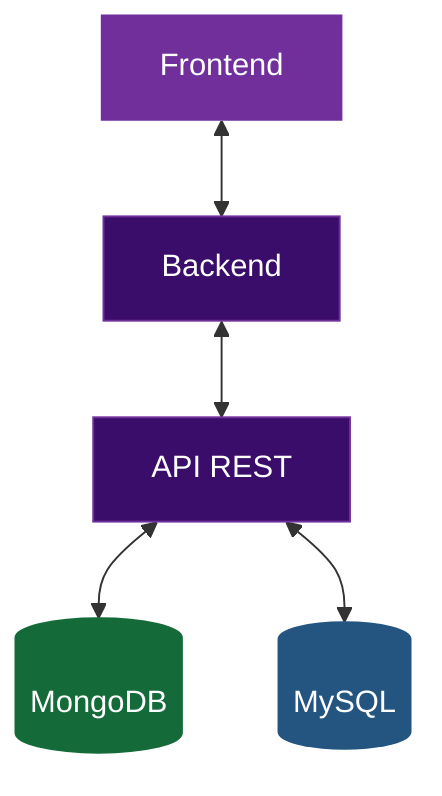

# Commusity

**Música, comunidad y conexión en un mismo lugar.**


## Descripción

**Commusity** es una red social enfocada en la música que reúne en un mismo espacio la reproducción musical, la organización de canciones mediante playlists y la interacción entre personas con gustos afines. Los usuarios pueden explorar el catálogo musical, registrar canciones y participar en comunidades dedicadas a sus artistas, géneros e intereses favoritos, compartiendo publicaciones, comentarios y canciones.

### Problemática

Actualmente, muchos usuarios escuchan y organizan su música en una plataforma, mientras utilizan otras para compartir sus intereses y conversar con personas que tienen gustos similares. Esta separación dificulta el descubrimiento de comunidades y contenidos musicales de interés.

Commusity propone integrar estas experiencias en una sola plataforma, facilitando la exploración de comunidades por géneros y términos de búsqueda, así como el intercambio de contenido musical entre sus miembros.

### Objetivo general

Diseñar e implementar un sistema de información que integre una base de datos relacional con MySQL y una base de datos no relacional con MongoDB, aplicando conceptos de modelado, almacenamiento, estructuración y consulta de datos para gestionar la información musical y las interacciones sociales de los usuarios.

El proyecto fue desarrollado como trabajo académico de Bases de Datos II de la Institución Universitaria Pascual Bravo.

## Funcionalidades de la versión 1.0

- Registro e inicio de sesión de usuarios.
- Registro y consulta de canciones; edición y eliminación únicamente por su propietario.
- Gestión de artistas y álbumes.
- Reproductor musical con controles de reproducción, progreso y volumen.
- Creación, edición y eliminación de playlists, con opciones para agregar y retirar canciones.
- Creación, edición y eliminación de comunidades.
- Exploración de comunidades, búsqueda por nombre, filtros por género y opciones para unirse o salir.
- Creación, edición y eliminación de publicaciones con canciones adjuntas opcionales, comentarios y likes.
- Búsqueda de canciones por título, artista o álbum; ordenamiento de publicaciones recientes o populares.
- Validaciones de propiedad para editar y eliminar contenido.

## Tecnologías

| Componente | Tecnología |
|---|---|
| Frontend | HTML5, CSS3 y JavaScript |
| Backend | Node.js y Express |
| Base de datos relacional | MySQL 8.0 |
| Base de datos no relacional | MongoDB |
| Acceso a datos | mysql2 y MongoDB Node.js Driver |
| Carga de archivos | Multer |
| Hash de contraseñas | bcryptjs |
| Variables de entorno | dotenv |
| Comunicación entre orígenes | cors |
| Control de versiones | Git y GitHub |

## Arquitectura

La aplicación utiliza una arquitectura cliente-servidor con un backend modular organizado en rutas, controladores, middlewares y configuración.



El diagrama resume los componentes de la aplicación. La API REST forma parte del backend Express; el frontend realiza peticiones HTTP a esa API y los controladores del backend consultan las bases de datos. No existe una conexión directa del navegador con MySQL ni MongoDB.

### Integración de bases de datos

**MySQL** almacena usuarios, canciones, artistas, álbumes, playlists y sus relaciones. Utiliza claves primarias, claves foráneas, restricciones y transacciones para preservar la integridad de los datos relacionales.

**MongoDB** almacena comunidades y publicaciones. Su modelo documental permite incorporar miembros, comentarios y likes mediante arreglos y documentos embebidos.

El backend integra ambas bases mediante identificadores compartidos, como `id_usuario` e `id_cancion`. Por ejemplo, una publicación almacena la referencia de una canción en MongoDB y el backend consulta MySQL para recuperar sus metadatos.

No existen claves foráneas entre ambos motores. Las referencias se validan mediante la lógica de la aplicación, sin garantizar una transacción distribuida entre las dos bases.

Los archivos MP3 se almacenan en el sistema de archivos del servidor; MySQL conserva sus rutas y metadatos.

## Diseño de las bases de datos

### Modelo relacional — MySQL (`proyectobd`)

El catálogo musical y los datos estructurados se organizan mediante entidades relacionadas. Estas son las principales tablas que intervienen en las funcionalidades de la versión 1.0:

| Tabla | Responsabilidad |
|---|---|
| `tbl_usuario` | Cuentas de usuario y credenciales. |
| `tbl_cancion` | Canciones, duración, ruta de audio y propietario. |
| `tbl_artista` | Información de los artistas. |
| `tbl_album` | Álbumes y su artista principal. |
| `tbl_playlist` | Listas de reproducción de cada usuario. |
| `tbl_artista_cancion` | Relación muchos a muchos entre artistas y canciones. |
| `tbl_playlist_cancion` | Relación muchos a muchos entre playlists y canciones. |

El modelo académico también contempla géneros, etiquetas y la biblioteca personal, junto con sus respectivas tablas intermedias. Su presencia en el diseño no implica que todas estas funcionalidades estén disponibles en la interfaz actual.

### Modelo documental — MongoDB (`red_musica`)

| Colección | Información almacenada | Estado |
|---|---|---|
| `comunidades` | Nombre, descripción, géneros, etiquetas, creador y miembros. | Implementada |
| `publicaciones` | Autor, comunidad, contenido, fecha, canción opcional, comentarios y likes. | Implementada |
| `mensajes` | Documentos individuales para mensajes de cada comunidad. | Reservada para el chat futuro |

Los comentarios y likes se almacenan dentro del documento de cada publicación. Las publicaciones se relacionan con su comunidad mediante `id_comunidad`, que referencia su `_id` de tipo `ObjectId`. Los identificadores de usuarios y canciones referencian registros de MySQL y se validan desde el backend.

## Estructura del proyecto

```text
TrabajoFinalBD/
├── Backend/
│   ├── audio/          # Archivos MP3
│   ├── config/         # Conexiones a MySQL y MongoDB
│   ├── controllers/    # Lógica de negocio y operaciones CRUD
│   ├── middlewares/    # Procesamiento y validación de solicitudes
│   ├── routes/         # Endpoints de la API
│   ├── .env            # Configuración local (no publicar)
│   ├── .gitignore
│   ├── package.json
│   ├── package-lock.json
│   └── server.js       # Configuración e inicio del servidor
├── Login/              # Registro e inicio de sesión
├── Main/               # Página principal y reproductor
├── Playlist/           # Gestión de playlists
├── Foros/              # Comunidades y publicaciones
├── NuevaPlaylist/      # Carpeta prevista en la estructura original
└── README.md
```

## Instalación y ejecución

### 1. Requisitos previos

- Node.js y npm.
- MySQL Server.
- MongoDB Community Server.
- Git (opcional si se descarga el repositorio como ZIP).
- Copia del esquema SQL actualizado y, si se desean los datos de demostración, respaldos de las bases y archivos MP3.

### 2. Instalar dependencias

Descargar o clonar el repositorio, abrir una terminal en la raíz del proyecto y ejecutar:

```bash
cd Backend
npm ci
```

### 3. Configurar MySQL

Iniciar MySQL Server e importar el esquema actualizado de la base de datos `proyectobd` (denominada `proyectoBD` en el documento académico). El esquema debe incluir la relación entre las canciones y sus usuarios propietarios.

### 4. Configurar MongoDB

Iniciar el servicio de MongoDB o ejecutar en una terminal independiente:

```bash
mongod
```

La aplicación utiliza la base de datos `red_musica`, con las colecciones `comunidades` y `publicaciones`. La colección `mensajes` está reservada para una versión futura.

### 5. Configurar las variables de entorno

Crear el archivo `Backend/.env`. Ejemplo de configuración local:

```env
PORT=3000
DB_HOST=localhost
DB_PORT=3306
DB_USER=tu_usuario
DB_PASSWORD=tu_contrasena
DB_NAME=proyectobd
MONGO_URI=mongodb://127.0.0.1:27017
MONGO_DB=red_musica
```

Los nombres de las variables de MySQL coinciden con los del archivo `config/db.js` de la copia revisada. Comprueba el nombre exacto de la base y las credenciales en tu instalación. Respeta las mayúsculas y minúsculas de las carpetas de tu repositorio; si se llama `backend`, utiliza ese nombre en los comandos. No publicar credenciales reales ni subir el archivo `.env` al repositorio.

### 6. Iniciar el backend

Desde la carpeta `Backend`, ejecutar:

```bash
npm start
```

Comprobar el estado de las conexiones en:

- [Estado del servidor](http://localhost:3000/api/salud)
- [Inicio de sesión](http://localhost:3000/Login/Inicio_de_sesion/inicio_sesion.html)

No es necesario utilizar Live Server, ya que Express sirve los archivos del frontend. La aplicación puede ejecutarse localmente sin conexión a Internet, siempre que las dependencias, bases de datos y archivos necesarios estén disponibles.

## API REST

Principales endpoints del sistema:

| Método | Endpoint | Descripción |
|---|---|---|
| GET | `/api/salud` | Comprobar las conexiones |
| GET | `/api/canciones` | Consultar canciones |
| POST | `/api/canciones` | Registrar una canción |
| PUT | `/api/canciones/:id` | Actualizar una canción propia |
| DELETE | `/api/canciones/:id` | Eliminar una canción propia |
| GET | `/api/artistas` | Consultar artistas |
| GET | `/api/albumes` | Consultar álbumes |
| GET | `/api/playlists` | Consultar playlists del usuario |
| POST | `/api/playlists` | Crear una playlist |
| GET | `/api/comunidades` | Consultar comunidades |
| POST | `/api/comunidades` | Crear una comunidad |
| POST | `/api/comunidades/:id/unirse` | Unirse a una comunidad |
| POST | `/api/comunidades/:id/salir` | Salir de una comunidad |
| GET | `/api/publicaciones/comunidad/:id` | Consultar publicaciones |
| POST | `/api/publicaciones` | Crear una publicación |
| PUT | `/api/publicaciones/:id` | Editar una publicación |
| DELETE | `/api/publicaciones/:id` | Eliminar una publicación |
| POST | `/api/publicaciones/:id/comentarios` | Agregar un comentario |
| POST | `/api/publicaciones/:id/likes` | Agregar un like |
| GET | `/api/publicaciones/comunidad/:id/estadisticas` | Consultar popularidad |

Las operaciones que requieren identificar al usuario reciben su identificador en el cuerpo o los parámetros de consulta, según el endpoint. Las operaciones de carga de canciones utilizan `multipart/form-data`.

## Seguridad e integridad

- Hash de contraseñas mediante bcryptjs.
- Consultas SQL parametrizadas.
- Transacciones para operaciones relacionadas con canciones y artistas.
- Validación de propiedad y pertenencia a comunidades.
- Prevención de likes duplicados mediante `$addToSet`.
- Validación de archivos MP3 y límite de carga de 20 MB.

### Limitaciones actuales

La identificación del usuario se conserva en `sessionStorage` y se envía al backend. Este mecanismo es provisional: el identificador puede manipularse y no constituye autenticación segura del lado del servidor. La aplicación está orientada a una demostración académica local, no a un despliegue público de producción.

La consistencia entre MySQL, MongoDB y los archivos de audio depende de las validaciones y operaciones del backend. Una canción eliminada puede dejar una referencia histórica en una publicación.

## Mejoras futuras — Versión 2.0

- Chat en tiempo real dentro de las comunidades.
- Biblioteca musical personal.
- Etiquetas de nicho para canciones y playlists.
- Reacciones de like y dislike sobre canciones (distintas de los likes de publicaciones).
- Recomendaciones de comunidades a partir de preferencias musicales.
- Autenticación segura mediante sesiones de servidor o tokens verificados.
- Fortalecimiento de la consistencia entre bases de datos.
- Paginación y optimización de consultas.

## Integrantes y contexto académico

- Jelen Mildrei Alzate Rivera
- Emmanuel Pino Ramirez

**Docente:** Maira Liseth Pérez Diaz  
**Grupo:** 001 ET0062  

**Institución:** Institución Universitaria Pascual Bravo  
**Programa:** Tecnología en Desarrollo de Software  
**Asignatura:** Bases de Datos II  
**Versión:** 1.0  
**Año:** 2026

Proyecto desarrollado con fines académicos para demostrar la integración de bases de datos relacionales y documentales en una aplicación web funcional.

La documentación académica *COMMUSITY - TRABAJO FINAL* recoge el planteamiento, el objetivo, la arquitectura general y los modelos de datos. Este README describe el alcance funcional de la versión 1.0 y separa las funcionalidades previstas para futuras versiones.
